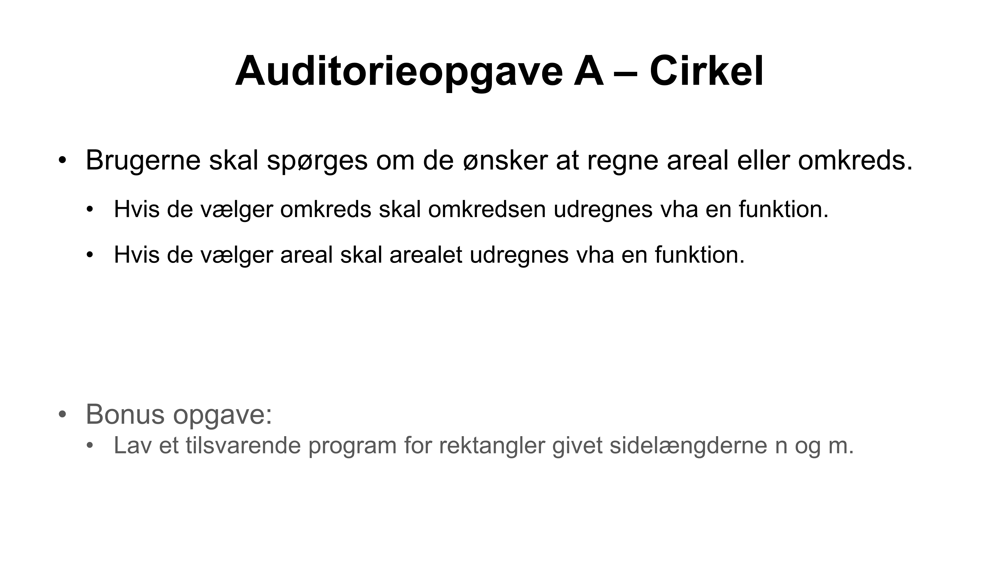
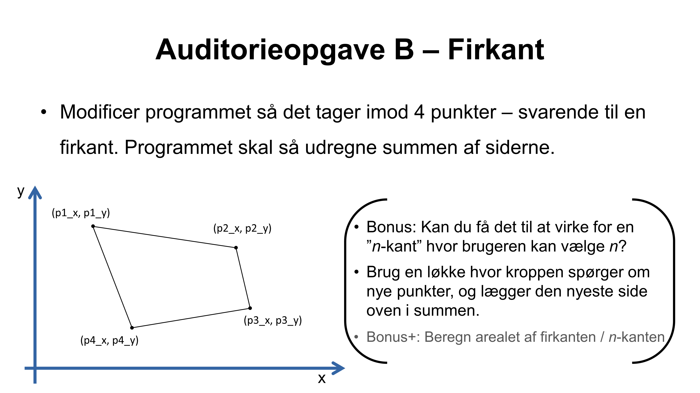

# Auditorieopgaver i Lektion 5
## Live coding 1
Under første live-coding session arbejder jeg (underviseren) i filen [src/live_cirkel.c](src/live_cirkel.c). 
Du kan evt. selv taste med her, eller du kan bare følge med på min skærm.

## Auditorieopgave A: Cirkel beregning
Du kan skrive din kode i filen [src/cirkel.c](src/cirkel.c). (Denne fil svarer cirka til det vi fik lavet under live-coding.)

---
## Live coding 2
Under anden live-coding session arbejder jeg (underviseren) i filen [src/live_trekant.c](src/live_trekant.c).
Du kan evt. selv taste med her, eller du kan bare følge med på min skærm.

## Auditorieopgave B: Trekant / firkant beregning
I skal nu udvide programmet i [src/trekant.c](src/trekant.c). (Denne fil svarer cirka til det vi fik lavet under live-coding.)

I laver nu følgende udvidelse med jeres sidemakker:

